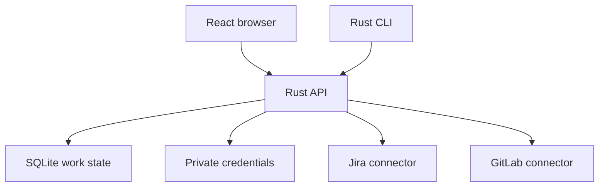

# Initial architecture

Both clients operate on the same API. The CLI is not a second database writer. The service enforces URL validation, credentials, grouping and synchronization. UI summaries are computed from the same source data returned to the CLI.

## Model

- **Connection:** UUID, provider, canonical base URL, stable remote account ID, display name, last successful sync and current sync error. The secret is separate from this record.
- **Item:** local ID namespaced by connection, remote identity, source URL, unmodified source status, derived outcome and the reason for it, attention category, source update time, optional effort. Manually added items have no connection.
- **Effort:** a manually named outcome with notes and linked items spanning services and hosts. It persists independently of agent sessions. Progress counts only delivered linked items. Closed-without-delivery and unknown items need attention, and abandoned items leave the total.
- **Outcome:** open, delivered, closed without delivery, abandoned or unknown, derived per connector in `src/outcome.rs`: GitLab from the merge request state, Jira from the status category and the resolution, manual items from an explicit choice. Abandoned is a person's decision; for synced items it is kept in its own column, so syncs preserve it like effort links.

The SQLite schema version is kept in `user_version`. Opening an older database copies it to `work.vN.sqlite`, then migrates it in one transaction; a newer one is refused.

The six provider identifiers are `jira`, `gitlab-internal`, `gitlab-public`, `github`, `fedora`, and `errata`. Internal/public GitLab share code; their URLs and credentials remain distinct. Different credentials are never tried as a fallback after an access error.

## Connectors

Connectors implement one interface, `Connector` in `src/connector.rs`: verify the account a credential belongs to, list the items relevant to it, and refresh tracked items, with typed errors (auth, transient, inaccessible item, invalid). The service passes the credential with each call. `connector::sync` runs a sync the same way for every connector and checks what it returns before anything is stored. The interface's types are also a versioned JSON protocol for third-party plugins; see `docs/plugins.md` for the protocol and why built-in connectors run in process.

## API

All `/api` routes require the local application's bearer credential or paired browser session. JSON responses never serialize provider credentials.

| Endpoint | Purpose |
| --- | --- |
| `POST /api/session` | Establish a browser cookie using the pairing credential |
| `GET /api/snapshot` | Connections, items, efforts |
| `POST /api/connections` | Verify an account and store its credential |
| `DELETE /api/connections/:id` | Disconnect and remove cached source items/credential |
| `POST /api/sync` | Sync all connected sources |
| `POST /api/efforts` | Create an effort and attach selected items transactionally |
| `POST /api/links` | Assign or unassign an item to an effort |
| `POST /api/items` | Add a manual source link |
| `PATCH /api/items/:id` | Update a manual link’s status, attention and outcome |
| `POST /api/items/:id/abandon` | Mark a synced item abandoned, or undo it |

Live source requests are GET-only. No comments, merges, ticket updates or agent dispatches occur.

## Next slices

1. Validate Jira Data Center and internal GitLab connectors against the user's actual instances. Use dedicated test credentials in the local application, never chat.
2. Specify Errata's exact API and authentication. Model advisory readiness independently of individual PR completion.
3. Implement GitHub and Fedora Forge adapters, preserving instance/account identity and explicit credential selection.
4. Add credential backends for OS keychain, mounted Podman secret files and existing CLI logins. Define credential renewal and revocation explicitly.
5. Add configurable prioritization, persisted source refresh schedules and bounded retries.
6. For hosted use, add user ownership to every connection, item and effort before exposing a listener. Add OIDC login and per-user encrypted credentials with a separate deployment key.
7. Evaluate T3 Code MCP as an optional executor. The effort/inbox database remains independent of any agent runtime. Do not assume its internal WebSocket API is a stable integration contract.

## References

- https://github.com/jmarrero/atomic-setup/tree/main/bot
- https://docs.gitlab.com/api/merge_requests/
- https://docs.gitlab.com/security/tokens/access_token_scopes/
- https://developer.atlassian.com/server/jira/platform/personal-access-token/
- https://developer.atlassian.com/server/jira/platform/rest/v10000/api-group-search/
- https://github.com/pingdotgg/t3code/blob/main/docs/user/source-control.md
