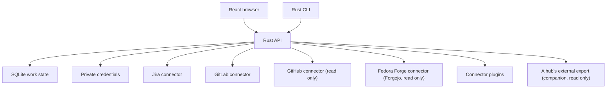

# Initial architecture

Both clients operate on the same API. The CLI is not a second database writer. The service enforces URL validation, credentials, grouping and synchronization. UI summaries are computed from the same source data returned to the CLI.

## Model

- **Connection:** UUID, provider, canonical base URL, stable remote account ID, display name, zone, its own sync interval if it has one, and for GitHub, optionally another user it watches. The secret is separate from this record, and so is its sync state.
- **Sync state:** per connection, in its own table: when its last successful sync started, its last attempt, when its next scheduled sync is due, its failures in a row, the kind and message of its last error, and until when its source asked to wait. It is written in the same transaction as what a sync found.
- **Item:** local ID namespaced by connection, remote identity, source URL, unmodified source status, derived outcome and the reason for it, attention category, the reasons it waits on the account (if it does), source update time, optional effort, and its connection's zone. When shown, a synced item also carries its connection's last success and whether that is stale. Manually added items have no connection and are internal.
- **Settings:** the data directory's mode, local or hub, recorded the first time a service opens it.
- **Hub link:** on a companion, the hub's address, its companion token (a credential file like a connection's), the state of its pulls (in the sync state table) and the last export they read.
- **Watch list:** what a GitHub connection found by watching another user, as of its last sync. It is stored apart from items, in its own table, so it never reaches the inbox, efforts or the external export.
- **Effort:** a manually named outcome with notes and linked items spanning services and hosts. It persists independently of agent sessions. Progress counts only delivered linked items. Closed-without-delivery and unknown items need attention, and abandoned items leave the total.
- **Outcome:** open, delivered, closed without delivery, abandoned or unknown, derived per connector in `src/outcome.rs`: GitLab from the merge request or issue state, Jira from the status category and the resolution, GitHub from whether a pull request merged and an issue's `state_reason` (completed is delivered; not planned, duplicate or no reason is closed without delivery), Fedora Forge (Forgejo) from whether a pull request merged, with every closed issue closed without delivery since Forgejo records no reason, manual items from an explicit choice. Abandoned is a person's decision; for synced items it is kept in its own column, so syncs preserve it like effort links.

The SQLite schema version is kept in `user_version`. Opening an older database copies it to `work.vN.sqlite`, then migrates it in one transaction; a newer one is refused.

The six provider identifiers are `jira`, `gitlab-internal`, `gitlab-public`, `github`, `fedora`, and `errata`. Internal/public GitLab share code; their URLs and credentials remain distinct. Different credentials are never tried as a fallback after an access error.

## Zones

Every connection has a zone, internal or external, chosen when it is connected (`connect --external`, the API's `zone` field, or the switch in the connection dialog). It belongs to the connection, not the provider: the same GitLab code serves an internal instance and gitlab.com, and either could be connected both ways. Internal is the default and can't be changed later; connections made before zones existed were migrated to internal. Internal work (Jira, internal GitLab, Errata) is synced only on the machine that runs the companion and never leaves it.

An item's zone is always read from its connection, never from what its own row says, and an item without a known connection is internal.

`zone::external_only` is the boundary, and every path that could take work off this machine goes through it. That is `GET /api/export/external` and `workboard export --external`; a hub serves it to its companions. A companion's own export is built from its own work alone, never from what it pulled from its hub. It passes only what is positively external: external connections; items that are external and belong to one of them; and efforts with at least one such item, with their progress over those items only. Each exported object is built field by field from an allowlist, and a test pins the keys of each, so a field added later stays behind until someone decides otherwise. Internal items and connections and their URLs never pass. Of an external connection's sync state, only its freshness (`last_success`, and `stale`, which is set unless the connection is known to be fresh) and its error's kind (auth, transient, inaccessible, invalid) do, since a message can name local paths. An effort's title and note are free text that may describe internal work: the note never passes, and the title only when a person shared it (`workboard share-title`, the API's `share_title`, or the switch on the effort); otherwise the hub sees "Effort" and the start of its random ID. An effort that mixes zones is exported with its external items alone, with no count or placeholder for the internal ones.

## Connectors

Connectors implement one interface, `Connector` in `src/connector.rs`: verify the account a credential belongs to, list the items relevant to it, and refresh tracked items, with typed errors (auth, transient, inaccessible item, invalid). Listed items carry the reasons they wait on the account; a connector that lists an item from several queries reports it once, with every reason. Jira, GitLab, GitHub and Fedora Forge (Forgejo) are built in, in `src/connectors/`; the other sources can be served by a connector plugin, an executable in the data directory's `plugins` directory run out of process (`src/connectors/plugin.rs`). `connectors::for_provider` picks the connector. The service passes the credential with each call. `connector::sync` runs a sync the same way for every connector and checks what it returns before anything is stored. The interface's types are also a versioned JSON protocol for third-party plugins; see `docs/plugins.md` for the protocol and why built-in connectors run in process.

## GitHub is read only

The GitHub connector holds a token that may be able to write: for testing it is the bot's own. Read-only is enforced in code, not by convention. `src/connectors/github/readonly.rs` is the only way to GitHub, and its single send checks each request exactly as it will go out:

- REST `GET` and `HEAD` under the instance's API root (`api.github.com`, or `api/v3/` on GitHub Enterprise Server) pass, except at the GraphQL endpoint or below it;
- `POST` to the GraphQL endpoint passes only with a JSON body of a `query` document and optional `variables`, when the document parses and every operation in it is a query. A mutation or subscription anywhere in it, even next to queries, an `operationName`, or anything else in the body refuses it. The document sent is printed from what was parsed, so GitHub reads what was checked;
- everything else is refused before it is sent, and counted.

Its HTTP client is private to that module, and clippy (`clippy.toml`, run with warnings denied) refuses the calls that could send another method anywhere in the crate unless marked as an exception. There are three exceptions: the one send of each read-only client, GitHub's and Fedora Forge's (below), after its check, and the CLI's calls to its own local service. reqwest sends a request through one of three paths, and each is covered:

- `Client::execute`, on a client or a reference to one: refused, since it sends a `Request` of any method;
- tower's `Service::call`, which `Client` and `&Client` implement, also when reached generically through `axum::ServiceExt`: refused, for the same reason;
- `RequestBuilder::send`: a builder from `Client::get` or `Client::head` can only read; the ways to build one with another method (`Client::post`, `put`, `patch`, `delete`, `request` and `RequestBuilder::from_parts`) are refused, and so is `Request::method_mut`.

An HTTP client other than reqwest would need a new dependency, which review would see. Each sync result says what was sent, by method, how many answers came back unchanged, and how many requests were refused.

The connector reads with REST search, whose quota is separate from GraphQL's. Searches are capped at GitHub's 1000 results, page on while GitHub counts more results than it returned, and fail rather than return part of them. Answers with an ETag are kept while the service runs, bounded in number and bytes and keyed by a hash of the token, so later requests ask conditionally, which doesn't count against the rate limit when nothing changed. A used-up rate limit fails the sync as transient and stops further requests until it frees up: for a primary limit (`x-ratelimit-remaining: 0`), only the requests of that resource (core, search or GraphQL); for a secondary limit (`retry-after`, or a refusal whose body says it hit one, then waited out for a minute), every request with that token. A tracked issue whose repository was transferred redirects; it is fetched at its new place once, if that is under the same API root, and is otherwise unknown. A wait GitHub asks for is honored for at most an hour, which covers its rate-limit window.

The answers kept for conditional requests stay in memory and are not carried across restarts. Keeping them would mean writing GitHub's raw answers (including private repositories a watched user can see) to disk, keyed by a token hash whose key would have to persist too, with the same bounds, for one cheaper round of requests after each restart; that isn't worth it while a restart costs one ordinary sync.

## Fedora Forge is read only

Fedora Forge is forge.fedoraproject.org, a Forgejo instance; [connectors/fedora-forge.md](connectors/fedora-forge.md) records how that was found, and why Fedora's Pagure dist-git has no connector. Its connector (`src/connectors/forgejo/`) is read-only the same way as GitHub's: `readonly.rs` is the only way to the instance, and its single send passes `GET` and `HEAD` requests without a body under the instance's `api/v1/`, on the same origin and without credentials in the URL, and refuses everything else before it is sent, counting it. The token goes in `Authorization: token ...`; a token with only the `read:user`, `read:issue` and `read:repository` scopes is enough, and can't write anyway.

Listings page with `limit` and `page` up to Forgejo's `x-total-count`, at most 1000 results, and fail rather than return part of them: past the cap, on an empty page short of the count, or when the count changes between pages, since a result could have moved from one page to another. Forgejo sends no ETags, so its requests are never conditional. It has no rate limit of its own; if it, or a proxy in front of it, answers 429 (or 503 with `retry-after`), the sync fails as transient and no request with that token goes to that instance until the wait is over (`retry-after`, or a minute). A renamed repository redirects, and is followed once if the new address is in the same API, as on GitHub.

## Scheduled sync

`src/schedule.rs` keeps every connection fresh, with no model involved. The service starts one scheduler task, which sleeps until the next sync is due (at most 30 seconds, so a clock that jumped, as when a laptop wakes, is noticed), and starts each sync that is due in a task of its own, so a slow or failing source never holds up another. Due times use the wall clock, the same one stored in the sync state.

- **Schedule:** a connection is due when it never synced, and then an interval after each success: its own (`connect --sync-interval`, `workboard schedule`, `PATCH /api/connections/:id`), or the service's (`serve --sync-interval`, 5 minutes by default), from 1 minute to 7 days. Each wait moves by up to 10% at random.
- **One sync per connection:** a connection never syncs alongside itself. A sync asked for while one runs (`workboard sync`, `POST /api/sync`, the page) joins it and gets its result, marked `coalesced`. A per-connection lock also keeps a change of what it watches, a new credential and a disconnect from overlapping its sync, and a sync whose connection was disconnected meanwhile saves nothing.
- **Backoff:** after a failure the next sync is due a minute later, doubling after each further failure, up to an hour. A source's rate-limit hold (GitHub's and Forgejo's clients say until when, in the error) makes it due no sooner than the hold's end. A rejected credential (`auth`) makes it due never: scheduled syncs stop, and the connection shows that it needs the person, until `workboard verify` (`POST /api/connections/:id/verify`) checks the credential again or replaces it with one for the same account. An explicit sync still runs.
- **Checkpoints:** a sync loads the previous items and state, fetches and checks everything, and only then saves the items, what watching found, and the new state, in one SQLite transaction (`Db::save_sync`). A failure saves only the new state. A sync cut short by a crash or a stop saves nothing, so the previous data and state stay, and since its state still says it is due, it runs again after a restart: nothing is skipped. Every sync fetches the complete lists, so there is no cursor that could move past unsaved data. If the state itself can't be saved, the scheduler waits the first backoff before trying that connection again.
- **Freshness:** a connection is stale when it never synced, or its last success is more than three intervals old. Items carry their connection's last success and stale flag, and a Mine row the oldest of its connections', with each account on it carrying its own connection's, so the page ages each by its own interval. A watch list keeps the time of the sync that found it, saved with it, and goes stale on that, since a failed watch keeps its list while the account's own syncs succeed. Anything whose freshness wasn't worked out counts as stale. The page works staleness out again as time passes from each connection's last success and interval, and marks everything synced stale, with a notice, while it can't reach the service.

- **The hub:** a companion's pulls from its hub are scheduled like a connection's syncs, on the service's interval, with the same backoff and the same stop after a refused token, and `workboard sync` pulls too. A pull saves what it read and its state in one transaction; a failed one keeps the last export. The hub's work is stale as soon as a pull fails.

The scheduler's tests run it with a clock they move by hand and fake connectors, so they check the schedule, the jitter's bounds, backoff, rate-limit holds, the stop after a rejected credential, that a connection never syncs alongside itself, joining a running sync, a sync cut short before it saved, and freshness, without waiting.

## Hub mode

`serve --hub` runs a hub, which keeps external work only; [hub.md](hub.md) covers its setup, its trust model and what crosses between it and its companion. In code:

- **Mode:** `Db::open_as` records the data directory's mode the first time it is opened (`settings`, schema version 6), and refuses to open it as the other. A directory from before modes were recorded becomes a hub only while empty. A hub checks its database holds nothing but external work before it starts.
- **Writes:** the SQL connection is private to `Db`, and each write method states what it writes as a `Write`, which `Db::admit` checks first. On a hub it passes only what is shown to be external: an external connection, what a sync of a stored external connection found if every item and watch list belongs to it and says external, efforts and links over its external items, and writes that add no work (sync state, decisions, disconnecting). Manual links, the demo and pulling from a hub are refused. The match lists every kind, so a new one has to be decided.
- **Access:** `Access` in `src/server.rs` checks every API request: its Host must be the loopback address or one of the hub's `--allowed-host` names, it needs the application token (bearer, or the cookie paired with it) or, only for `GET /api/export/external`, a hub's companion token, and a browser's change needs the origin of the name it came by, HTTPS under a hub's names. A session cookie set under those names is Secure.
- **Pulls:** `src/hub.rs` is the companion's only way to its hub. Its one send passes a `GET` of the export at the hub's exact address without a body, and refuses everything else before it is sent, counting it; redirects are never followed, and clippy refuses the other ways to send. What comes back is checked whole (`hub::checked`) before anything is kept.
- **Board:** `hub::merge` adds the hub's connections, items and efforts to what the companion shows, under IDs starting with `hub:`, marked `from_hub`, read-only, and leaves out a hub connection to an account the companion connects too, with its items. It is only for showing: the snapshot and Mine view use it, the export never does.

## Mine

The Mine view (`workboard mine`, `GET /api/mine`, the Mine tab) lists the open items that wait on the account behind each connection, with why: review requested (directly or through a team), assigned, mentioned, or the account's own change needs action (changes requested or failing checks), plus GitLab's other to-do items. Each row shows the source's status, the outcome, the zone and the link, and each account it waits on with that account's own reasons. An item found by several listings or connections shows once, and counts as internal if any of its connections is. It is a local view; the external export carries each external item's reasons, so a companion shows the hub's external work in its own Mine view, as the hub's account's.

Where the reasons come from:

- GitHub: searches for `review-requested:@me` and `user-review-requested:@me` (GitHub refuses `team-review-requested:@me`, so team requests are those the first finds beyond the second), `assignee:@me`, and the account's open pull requests with `review:changes_requested` or `status:failure`. Its other open pull requests are in the inbox, waiting, without a reason.
- GitLab: open merge requests assigned to the account or asking its review, and its pending To-Do items (`/todos`) on merge requests and issues. To-dos on commits, epics and designs aren't items yet.
- Jira: the unresolved issues assigned to the account.
- Fedora Forge: Forgejo's issue search (`/repos/issues/search`) with `review_requested` (pull requests), `assigned` and `mentioned`. The review filter matches requests to the account's teams too, so each pull request's `requested_reviewers` tells a direct request from a team one. The account's own open pull requests (`created`) are in the inbox, waiting, without a reason; Forgejo's search can't tell which have changes requested or failing checks. Notifications aren't read: they cover every repository the account watches.

A GitHub connection can also watch another login's activity (`connect --watch-user`, `workboard watch`, `PATCH /api/connections/:id`), a setting of its own, for when the token isn't that person's: `review-requested:LOGIN` (a team request unless `user-review-requested:LOGIN` also finds it), `assignee:LOGIN` and `author:LOGIN`. The searches run with the connection's token, so they find what that token can see, private repositories included. What they find is listed under Watching, with the watched login, and never as the account's. A watch that fails, such as for a renamed login, doesn't fail the account's own sync: the last list found for that login stays, with the error, in `mine` and the sync result.

## API

All `/api` routes require the local application's bearer credential or paired browser session; a hub's companion token reads `GET /api/export/external` and nothing else. JSON responses never serialize provider credentials.

| Endpoint | Purpose |
| --- | --- |
| `POST /api/session` | Establish a browser cookie using the pairing credential |
| `GET /api/snapshot` | Connections, items, efforts, the service's mode, and on a companion the hub's work and how its pulls go |
| `GET /api/export/external` | The external zone only, as a hub serves it to its companions |
| `GET /api/hub` | The hub a companion pulls from, and how its pulls go |
| `PUT /api/hub` | Pull from a hub (`url`, `token`), once a first pull works |
| `DELETE /api/hub` | Stop pulling from the hub, and forget its token and work |
| `GET /api/companion-token` | A hub's companion token |
| `POST /api/companion-token` | Replace a hub's companion token |
| `GET /api/mine` | What waits on each connection's account, and apart from it what watching found |
| `POST /api/connections` | Verify an account and store its credential |
| `PATCH /api/connections/:id` | Watch another GitHub user from a connection, or stop; change how often it syncs (`sync_interval` in seconds, null for the default) |
| `POST /api/connections/:id/verify` | Check a connection's credential again, or replace it (`token`) with one for the same account; resumes its scheduled syncs |
| `DELETE /api/connections/:id` | Disconnect and remove cached source items/credential |
| `POST /api/sync` | Sync all connected sources now, or one (`connection`), joining syncs already running |
| `POST /api/efforts` | Create an effort and attach selected items transactionally |
| `PATCH /api/efforts/:id` | Let an effort's title leave in the external export, or stop |
| `POST /api/links` | Assign or unassign an item to an effort |
| `POST /api/items` | Add a manual source link |
| `PATCH /api/items/:id` | Update a manual link’s status, attention and outcome |
| `POST /api/items/:id/abandon` | Mark a synced item abandoned, or undo it |

Live source requests only read: GET, and for GitHub, GraphQL queries checked as described above. No comments, merges, ticket updates or agent dispatches occur. A companion's requests to its hub are GETs of its export, and nothing else.

## Next slices

1. Validate Jira Data Center and internal GitLab connectors against the user's actual instances. Use dedicated test credentials in the local application, never chat.
2. Specify Errata's exact API and authentication. Model advisory readiness independently of individual PR completion.
3. Decide whether Fedora's package dist-git, still Pagure on src.fedoraproject.org while it moves to Forgejo, gets a connector of its own first (see `docs/connectors/fedora-forge.md`).
4. Add credential backends for OS keychain, mounted Podman secret files and existing CLI logins. Define credential renewal and revocation explicitly.
5. Add configurable prioritization.
6. For hosted use, add user ownership to every connection, item and effort before exposing a listener. Add OIDC login and per-user encrypted credentials with a separate deployment key.
7. Evaluate T3 Code MCP as an optional executor. The effort/inbox database remains independent of any agent runtime. Do not assume its internal WebSocket API is a stable integration contract.

## References

- https://github.com/jmarrero/atomic-setup/tree/main/bot
- https://docs.gitlab.com/api/merge_requests/
- https://docs.gitlab.com/security/tokens/access_token_scopes/
- https://developer.atlassian.com/server/jira/platform/personal-access-token/
- https://developer.atlassian.com/server/jira/platform/rest/v10000/api-group-search/
- https://github.com/pingdotgg/t3code/blob/main/docs/user/source-control.md
- https://forgejo.org/docs/v15.0/user/api-usage/
- https://forgejo.org/docs/v15.0/user/token-scope/
